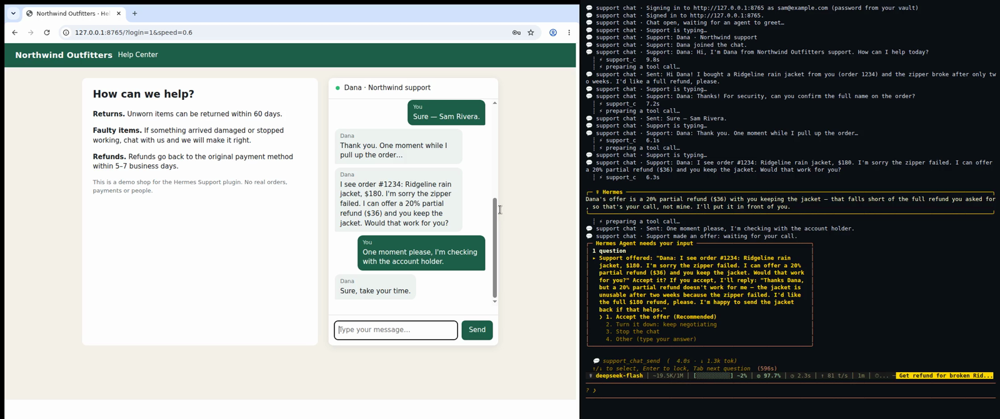

# Handle It

**Your agent sits in the customer support chat so you don't have to: you tell Hermes what you want from a company, and it sits in that company's live support chat on your behalf until it's done.**

A [Hermes Agent](https://github.com/NousResearch/hermes-agent) plugin. (Not a help desk for Hermes itself: it is Hermes being your representative in someone else's support chat.)

> "Northwind's support chat is at northwind.example/help. The zipper on my jacket broke after two weeks. Get me a full refund for order 1234. You can share the order number and my name."

Hermes opens the chat in a browser (when the chat needs you signed in, Hermes signs in first in its own browser with its vault), explains the problem, answers the agent's questions, waits through "let me check with my supervisor", and comes back to you only when there is a decision to make. Every offer is your call:

```
╭─ Hermes Agent needs your input ─────────────────────────────────╮
│ ▸ Support offered: "I can offer a 20% partial refund ($36) and  │
│   you keep the jacket. Would that work for you?" Accept it?     │
│   If you turn it down, I'll reply: "Thanks, but the jacket is   │
│   unusable after two weeks. I'd like the full $180 refund."     │
│   ❯ 1. Accept the offer                                         │
│     2. Turn it down: keep negotiating                           │
│     3. Stop the chat                                            │
╰─────────────────────────────────────────────────────────────────╯
```

It ends with the outcome ("Refund RF-48213, $180, 5–7 business days") and a saved transcript with screenshots.

## Demo



One ask; Hermes holds a chat with a scripted "human" agent on a stand-in shop, brings you the 20% partial-refund offer (you turn it down), pushes on, brings you the full refund (you approve), done.

## Why a plugin and not a prompt

A model told to "go handle my support chat" will happily say yes to the first offer, paste your phone number when asked, or give up when the agent goes quiet for four minutes. The plugin puts code, not instructions, between the model and the chat:

- **The approval gate.** Every outgoing message is checked before it is typed. When support makes an offer and asks for a yes, the answer is yours, whichever way the model leans: you see the offer and the reply Hermes drafted, and accept or turn it down. Anything that pays, buys, cancels or authorises something is shown to you first too. *Silence accepts nothing*: no answer means nothing is sent. While you decide, Hermes tells the agent "One moment please, I'm checking with the account holder." Card numbers are never typed at all, even with a yes: paying is left to you.
- **The shareable-details list.** You say what Hermes may share (`order number`, `name`, `email`…). Email addresses, phone numbers, account or card numbers and secrets (passwords, one-time codes) that are not on the list, not in your own words and not first said by support, need your OK. So does any answer to "can you confirm your …?" that contains none of the listed details. Values you mark `never_share` are caught verbatim.
- **The waiting loop with no time cap.** Hermes polls the chat every second and counts a reply once support has been quiet for three seconds and is not typing, so a reply split over several bubbles arrives whole. A wait that runs out returns `still_waiting` and Hermes waits again: an hour on hold is just more waits. Every step is saved, so a chat survives the end of a turn or a restart of Hermes and carries on from its saved transcript, in the same browser profile so the chat widget finds its conversation again.
- **Sign-in through Hermes, never through the plugin.** When the chat sits behind a login, Hermes signs in with its own vault (`browser_vault` fill and enter_code, on Hermes's browser) before the chat starts; the plugin never reads a password or a code. This needs Hermes's `browser.cdp_url`, so that the plugin opens the chat in that same browser and its sign-in.
- **Public addresses only.** The chat browser resolves every page, every redirect hop and every frame before it loads, and refuses private, loopback, link-local and CGNAT addresses and cloud metadata endpoints (169.254.169.254 and the like), as Hermes's own browser policy does. Your Hermes opt-out (`security.allow_private_urls`) lifts the private-address floor only, never the metadata one.
- **Progress.** Each step (`Support is typing…`, `Support: …`, `Still holding the support chat (120s without a reply)`) is published through Hermes as the plugin event `hermes-handle-it:progress` and written to Hermes's log, and every reply is screenshotted into the chat's folder.

## Install

Requires Hermes Agent ≥ 0.21.5 and Playwright with a Chromium.

```bash
hermes plugins install casualsav/hermes-handle-it --enable
# Playwright's Chromium, if this machine has none:
~/.hermes/hermes-agent/venv/bin/python -m playwright install chromium
```

Or by hand: copy this directory to `~/.hermes/plugins/hermes-handle-it/`, then `hermes plugins enable hermes-handle-it`. Start a new Hermes session; `hermes tools list` shows the `support_chat` toolset.

## Use

Just ask, with the chat's address and what Hermes may share:

> "Cancel my Acme Cloud subscription and get the last month refunded. Their chat is on acme.example/support. You can share my account email sam@example.com."

Tools the model uses (you don't call them yourself):

| tool | does |
|---|---|
| `support_chat_start` | opens the page, finds the chat box (clicking a "Chat with us" button if needed), waits for the greeting |
| `support_chat_send` | sends one message through the approval gate, then waits for the reply |
| `support_chat_wait` | keeps holding without sending |
| `support_chat_end` | closes the chat, writes `transcript.md`, returns the outcome |

Chats live in `$HERMES_HOME/hermes-handle-it/chats/<time>-<id>/`: `transcript.md`, `session.json` and a screenshot per reply.

### Where the approval appears

A message that agrees, pays, cancels or shares a detail you did not allow goes through Hermes's approval gate (a `pre_tool_call` hook) on every surface, CLI and gateway (Telegram, Discord…) alike, so it arrives the way your approvals do, including any approval transport plugin you use. When the model turns an offer down, the tool asks you itself through Hermes's question prompt (the card above). If approvals are turned off, nothing that needs your OK is sent; Hermes tells you what support offered instead.

### Browser

Handle It runs its own Chromium through Playwright, with a profile in `$HERMES_HOME/hermes-handle-it/browser-profile`. It is headless by default; it shows its window when Hermes's `browser.headed` is set or `AGENT_BROWSER_HEADED=1`, which is how the demo shows it on a desktop. If Hermes's `browser.cdp_url` is set, it opens the chat in that browser, Hermes's own, instead: this is what a chat behind a sign-in needs, since the sign-in Hermes made there carries into the chat.

## Try the demo yourself

```bash
python demo/serve.py            # Northwind Outfitters help center on http://127.0.0.1:8765/
hermes config set security.allow_private_urls true   # the demo is on 127.0.0.1; set it back afterwards
hermes chat
> Northwind Outfitters' support chat is at http://127.0.0.1:8765/ - the zipper on my Ridgeline
  rain jacket broke after two weeks. Get me a full refund for order 1234. You can share the
  order number and my name, Sam Rivera.
```

Add `?login=1` to put the chat behind a sign-in (demo password `northwind-demo`; save it with `hermes vault add` for origin `http://127.0.0.1:8765`, and set `browser.cdp_url` so the chat opens in Hermes's browser), or `?login=2fa` to add a code step. The stand-in "human" agent, Dana, replies with realistic pauses and a typing indicator, asks for the order number and the name on the order, offers a 20% partial refund, checks with a supervisor if you hold out, then offers the full $180. Add `?speed=0.3` to the URL to make her quicker. `demo/record/record.sh demo/raw` reproduces the recording on a virtual display (needs Xvfb, tmux, ffmpeg): the agent's screen and the user's terminal as two aligned videos.

## Phone calls (bland.ai)

Handle It can also phone a company's support line for you, through [bland.ai](https://www.bland.ai). Calls use your own bland.ai account: `BLAND_API_KEY` in your Hermes profile's `.env` (`hermes plugins install` asks for it; leave it empty if you only want chats). Hermes reads it per profile.

> "Call Best Buy's customer care on +1 888 237 8289 and ask what their return window is for online orders."

bland.ai's voice agent places the call and gets through the company's phone menu from what you asked, with no key sequence given in advance. It says at once that it is an AI assistant calling for a customer. It knows only the details you allow, and it talks to support. The tools are `support_call_start`, `support_call_wait` and `support_call_end`. A call is capped by `max_minutes` (default 30). The transcript, outcome and cost are saved under `$HERMES_HOME/hermes-handle-it/calls/`.

What calling is and is not:

- **Asking before calling.** A call costs money, so Hermes asks you before placing it, at its approval prompt, with the number, the company, the maximum minutes and whether it is recorded. With approvals turned off, no call is placed.
- **Approval of offers.** By default, an offer made on a call comes back to you after the call ends, not during it. The voice agent is told it cannot agree to anything, so it gets the offer noted and says you will follow up. You get approval during the call only if you run a public HTTPS address for this machine's approval bridge (the plugin setting `call_bridge_url`, for example a tunnel). bland.ai can then ask you through Hermes while support holds.
- **Speech.** The voice agent speaks without going through this plugin. The plugin checks the call's transcript afterwards against your allowed details and approvals, and notes anything outside them.
- **Tried:** once, on a real retailer's automated support line. It asked a general question, the return window for online orders, and came back with the answer in 1.6 minutes for $0.22.
- **Not tried:** a human support agent on the line, and approval during a call.

Recording (`record: true`) keeps bland.ai's recording of the call, and the agent says the call is being recorded. Costs are bland.ai's and they are yours: about $0.14 per connected minute on its free plan. Details are in [docs/phone.md](docs/phone.md).

## What it has been tried on

- **Tried:** the demo shop above, end to end in Hermes Agent 0.21.5 on Linux (arm64) with DeepSeek as the model, in the CLI; on a Telegram gateway (Hermes Agent 0.23.1), where each acceptance arrived as Hermes's approval card with its buttons: one approved and sent, one left unanswered that timed out with nothing sent; in tests, the chat inside the page, the same chat inside an iframe behind a "Chat with us" launcher (the shape of Intercom, Zendesk and similar widgets), a sign-in made in the browser at `browser.cdp_url` carrying into the chat, and redirects and frames into private and metadata addresses being stopped before they load. Unit tests cover the guard (including an offer stated without a question, and a reply that takes it without saying "agree"), the reader, the waiting loop, approvals and restart.
- **Not tried yet:** a real company's live chat (it would mean talking to real people at a real company; real widgets add cookie banners, pre-chat forms, canvas and closed shadow DOM), macOS, a sign-in with `browser_vault` end to end in a Hermes session with a model, and chats that require a pre-chat form first (`support_chat_start` reports that it found no message box).

How it reads any chat: it compares the visible text of the page and all its frames between polls, so it needs no per-site code; it finds the message box by its role and label, and presses Enter or the Send button. Widgets that draw messages on a canvas or in closed shadow DOM would need more.

## Design

The conversation loop (`session.py`) talks to a *channel* with five methods: `text()`, `send()`, `find_composer()`, `screenshot()`, `close()`. The browser page (`browser.py`) is the one channel today; a phone channel through a calling plugin could implement the same five and reuse the loop, the guard and the approvals unchanged.

```
__init__.py   register(): seven tools, the pre_tool_call approval hook, the post_tool_call hook that closes a chat on an unanswered card, on_session_finalize
handlers.py   tool schemas and handlers, reaching the user (approval, progress)
session.py    the loop: wait for replies, gate every message, save state, transcript
guard.py      what needs the user's OK: details not allowed, commitments, card numbers
reader.py     turning page text into "Dana: …" messages, typing and end-of-chat markers
browser.py    Playwright on its own thread, persistent profile, chat box and launcher finding
netguard.py   which addresses the browser may open: every page, redirect hop and frame
bland.py      bland.ai's call API: place, read, stop
phone.py      a support call: its instructions, the approval bridge, transcript and check
phone_tools.py the three call tools
demo/         the stand-in shop, its server, and the recording script
```

## Development

```bash
pip install pytest "playwright>=1.40,<2" && python -m playwright install chromium
python -m pytest tests      # tests/test_demo_shop.py drives the real demo shop in Chromium
hermes plugins validate .
```

The plugin's name is set once, in `plugin.yaml` (`name:`); the data folder follows it.

## Disclosure

Opens the support pages you name in a local Chromium (or in Hermes's own browser when `browser.cdp_url` is set), public addresses only, and types into them on your behalf. For phone calls, it talks to bland.ai's API with your own key (BLAND_API_KEY, read through Hermes's profile-scoped secrets), places phone calls to the numbers you name only after you approve each one, and bland.ai records the call when you ask it to; call costs are yours, billed by bland.ai. Never reads passwords or Hermes's vault: sign-ins are Hermes's own. Saves transcripts, screenshots and the browser profile under `$HERMES_HOME/hermes-handle-it/`. No other network calls, no telemetry, no stored credentials.

## License

MIT
